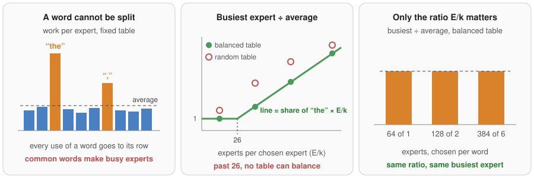
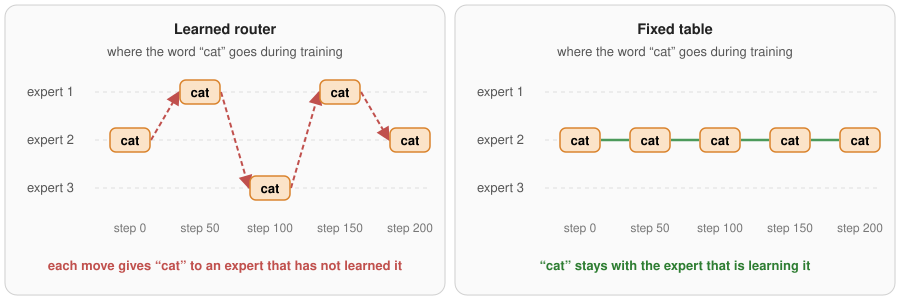
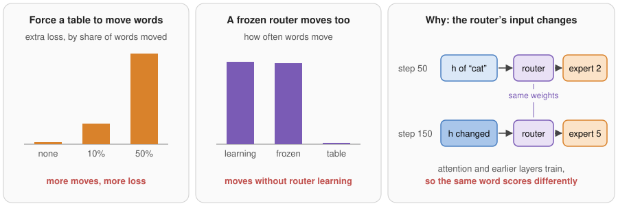
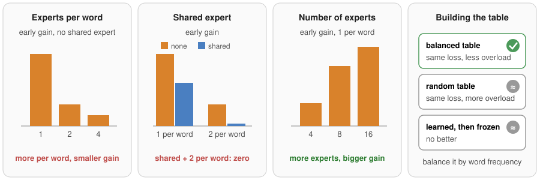
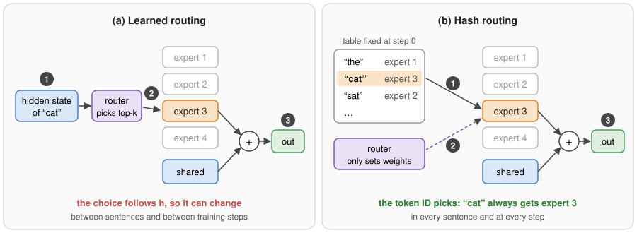
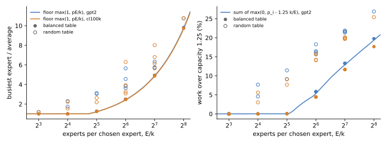

# Hash Routing: When Should Each Token in the Vocabulary Have Its Own Fixed Expert?

Vuk Rosić

## Abstract

Give every word of the vocabulary its own fixed expert, and the experts that hold "the" do all of its work: about one token in 26 of English web text, because a table cannot split a word between experts. So the busiest expert carries at least the most common word's share times the number of experts per chosen expert. With 64 experts per chosen one, as in DeepSeek-V4's 384 experts with 6 chosen, that is 2.4 times the average. Below 26 experts per chosen expert, a table balanced by word frequency spreads the work evenly; above it, no table can. Only this ratio matters, not the number of experts: 64 experts with 1 chosen and 384 with 6 chosen give the same busiest expert. Under a capacity limit, the work that overflows is the sum, over the common words, of how far each word's share exceeds its experts' capacity. So the whole load cost of a fixed table is known from word counts before training.



*Figure 1. A table cannot split a word, so the experts of the most common words are the busiest. Past 26 experts per chosen expert no table can balance, and only that ratio matters.*

The same limit binds a learned router whenever it routes by word, and in our models it does: a learned router sent two thirds or more of each word's uses to one expert, and its busiest expert sat at the same limit. On web text, the fixed table never trains worse than a learned router. It is ahead early in training, because a learned router keeps moving words between experts. Each move takes a word away from the expert that has learned it and hands it to one that has not. The moves do not come from the router learning: a router frozen at its random start moves words just as often, because its input, the hidden state, keeps changing as the rest of the model trains. The lead shrinks as training goes on and is gone once each weight has seen a few hundred tokens with few experts; with many small experts it lasts longer.



*Figure 2. A learned router keeps moving a word between experts during training. A fixed table never moves it.*



*Figure 3. The early loss follows the moves. Making a fixed table move words on purpose costs loss in proportion to how many it moves.*

The early lead is largest with one expert per word, no shared expert and many experts, and it vanishes with a shared expert, several experts per word and few experts, because a move only damages the share of the word's output that the moved expert carries. The best table keeps each word on one fixed expert set, sorts words by frequency and cuts the list into runs of equal total frequency: rare words then share experts with other rare words instead of being drowned out by common ones, and the load is balanced. Almost all of the early gain comes from the first layer, where the hidden state is still close to the word itself, so its experts work as a memory for each word and moving a word throws that memory away. A table loses only when the same word needs different handling in different contexts and training is long, and then keeping a learned router in one layer is enough to win the loss back, which fits hashing only the first layers, as DeepSeek-V4 does. The load limit can be lifted: send the three most common words only to the shared expert, and a table balances up to 42 experts per chosen expert instead of 26, at no measurable loss; send ten, and it balances up to 87. Starting with a table and switching to a learned router later is worse than either one alone.



*Figure 4. When the fixed table helps early in training, and how to build it. Bar heights show the shape of each trend.*

We prove the load limit, compute it exactly from the word counts of two tokenizers in 14 expert designs each, and check it in training, where the predicted overflow and busiest load match the measured ones. We show that the moves cause the early loss by forcing a fixed table to move words and by freezing the router's weights. We imitate long training with tiny models that see up to 248 tokens per weight, and repeat the key runs to measure noise.

## 1. What hash routing is

A mixture-of-experts (MoE) feed-forward layer replaces one feed-forward block with E smaller blocks called experts, plus, in many designs, one shared expert that every token uses. A router picks k of the E experts for each token:

```text
scores = sqrt(softplus(W_r h))          # one score per expert, from the hidden state h
chosen = top_k(scores + bias)           # learned routing
y      = shared(h) + sum_{e in chosen} w_e * expert_e(h)
```

Hash routing replaces the `top_k` line with a table fixed before training:

```text
chosen = table[token_id]                # k experts per vocabulary token, fixed once
```

The router can still set the weights `w_e` of the chosen experts, as in DeepSeek-V4. In "The cat sat", the position of " cat" always uses the experts in row " cat" of the table, in every sentence and at every training step. A learned router picks from the hidden state, so the same word can go to different experts in different sentences and, as Section 9 shows, at different steps of training.



**Figure 5.** (a) Learned routing: the router reads the hidden state (1), picks top-k experts (2), and the output is the shared expert plus the chosen experts (3). (b) Hash routing: the token ID picks the experts from a fixed table (1); the router only weights them (2).

The table costs no compute and `V x k` small integers per layer. Two ways to fill it:

```text
random:    each token gets k experts drawn at random
balanced:  tokens from most to least common, each gets the k experts with the least total frequency so far
sorted:    tokens from most to least common, cut into E runs of equal total frequency (Section 10)
```

## 2. Who uses it today

| User | How | What they report |
|---|---|---|
| Hash Layers, Roller et al. 2021 | Top-1 hash in one layer, no shared expert | Beats Switch routing; the lead grows from 16 to 128 experts; random table about equal to a balanced one. Suggests in one sentence that learned routing is hard because each expert's members change while it learns |
| StableMoE, Dai et al. 2022 | Learn a router for 10% of training, then freeze a distilled copy | Names "routing fluctuation": 41% of tokens still change expert after 20% of training. The frozen router beats Hash Layers (18.93 vs 19.25 PPL, 124M backbone, top-1) |
| Clark et al. 2022 | Hash vs learned routers up to hundreds of billions of weights | Hash worse than a balanced learned router (S-BASE) at most sizes |
| OpenMoE, Xue et al. 2024 | Analysis of a trained MoE | Learned routing is mostly by token ID and settles early |
| Fan, Messmer, Jaggi 2024 | Frozen random router | About equal to a learned router |
| DeepSeek-V4, 2026 | Hash routing in the first 3 MoE layers; 1 shared expert plus 6 of 256 or 384 routed experts | No reason given |

These papers report that hash routing is competitive in loss. None gives the load a fixed table must carry, which design choices set it, or when a table can be balanced at all. None shows why a table can lead early, and none tests whether expert moves cause the loss; StableMoE's evidence is correlational.

## 3. The claims

| # | Claim | Section |
|---|---|---|
| 1 | A fixed table's busiest expert carries at least max(1, p E/k) times the average, where p is the most common token's share. A frequency-balanced table reaches this limit, and only the ratio E/k matters | 5 |
| 2 | Under a capacity limit, a balanced table overflows by the sum over tokens of max(0, p_i - c k/E); a random table overflows more | 6 |
| 3 | A learned router that routes by word hits the same limit | 7 |
| 4 | On web text, a fixed table never trains worse than a learned router; it leads early and ties after long training | 8 |
| 5 | The early lead comes from the learned router moving words; a move costs more the more of the word's output one expert carries, and the more experts there are | 9 |
| 6 | Fill the table by frequency order cut into runs of equal total frequency: it balances the load and lowers loss after rare words. Spreading a word over experts costs loss | 10 |
| 7 | The early gain comes from the first layer. A table loses only when words need context-dependent experts and training is long, and one learned layer wins it back | 11 |
| 8 | Sending the few most common words only to the shared expert lifts the load limit at little loss; switching from a table to a learned router mid-training does not combine their strengths | 12 |

Claims 1 and 2 are proven for any token frequencies and checked exactly on two tokenizers and in training. Claims 3 and 6 held in every setting tested; claim 4 held on web text in every setting and fails when many words have two jobs (claim 7). Claim 5's sizes are trends over 8 designs. Claim 7's first half held in 4 settings; its second half rests on 2-layer models and tied in a 4-layer model. Claim 8's load numbers are exact; its loss numbers are 2 repeats of each setting.

## 4. Setup

**Load, without training (`rule.py`).** Token frequencies of FineWeb web text under two tokenizers: GPT-2 (50K tokens, counts over the whole training set) and cl100k (100K tokens, 3M tokens of the same text re-tokenized). The most common token is 3.82% and 3.78% of text, so 1/p is about 26 for both. For 14 designs from 8 experts with 1 chosen to 768 with 6 chosen, we build a random and a balanced table and compute each expert's exact share of the routed work, for an infinitely large batch.

**Model.** Pre-norm transformer with RMSNorm, RoPE, QK-norm, no biases, untied output head. Every feed-forward block is a DeepSeek-style MoE: sqrt(softplus) router scores, aux-loss-free balancing (a per-expert bias moved by 0.01 per step toward equal load), router weights renormalized over the chosen experts. Active feed-forward width equals a dense SwiGLU block; with a shared expert, the shared expert takes half of it and the k routed experts share the rest. Muon (Newton-Schulz, momentum 0.95, lr 0.02) trains block matrices, one expert matrix at a time; Adam (betas 0.9, 0.95, lr 0.01) trains embeddings, head, norms and router.

**Data.** FineWeb (GPT-2 tokens) mapped to the V-1 most common tokens plus an unknown token. In the short runs, planted ParaRel fact sentences fill 10% of rows.

**Short runs.** Width 32, 2 layers, 4 heads, vocabulary 4,000, 16 rows of 48 tokens per step, 200 steps, warmup 20 steps, linear cooldown over the last 30%. 3 to 7 s on a laptop CPU.

**Long runs.** To imitate the many tokens each weight sees in a large model, we shrink the model: width 8 or 16, vocabulary 500 or 4,000, batches of 16 to 128 rows, up to 2,400 steps. These models see 37 to 248 tokens per weight in 15 to 30 s (DeepSeek-V3 saw about 22 tokens per total weight). A small vocabulary maps rare words to one unknown token, 42% of text at vocabulary 500 and 20% at 4,000, which no real model has. A table would send it to one expert. So in long loss runs the unknown token uses the learned router in hashed layers, and in load and capacity runs it uses only the shared expert and is left out of load in both arms.

**Scores.** Web loss on 300 held-out FineWeb rows. Churn: the share of held-out positions whose set of experts changed between two checkpoints, averaged over layers. Token share: the share of a word's uses (words seen 5 or more times) that go to its most common expert set. Busiest / average: the busiest expert's load divided by the mean, per training batch, averaged over the last quarter of training. Dropped: the share of routed work over capacity.

**Tests.**

| Test | What it tells |
|---|---|
| Exact load of random and balanced tables, 2 tokenizers, 14 designs | Claims 1, 2 |
| Measured load and overflow in training vs the prediction from word counts | Claims 1, 2 |
| Capacity limits 1.0, 1.25, 2.0 with random, balanced and learned routing | Claim 2's cost in loss |
| Busiest expert of learned routers in every layer of 2- and 4-layer models | Claim 3 |
| Table vs learned in 8 designs, 13 other settings, and long runs to 248 tokens per weight | Claim 4 |
| Churn of a normal, slowed, frozen and word-only router; forced moves of a table in 8 designs | Claim 5 |
| Random, greedy balanced, sorted, grouped by use, learned-then-frozen tables; words spread by the previous word | Claim 6 |
| Hash one layer at a time in 4- and 6-layer models; replace one learned layer's routing by a per-word table at test time; words split into two pieces; reversed rows with long training | Claim 7 |

**Noise.** Three repeated runs of the same setting differed by up to 0.02 in web loss in the short runs and by up to 0.015 in the long 64-expert runs, so smaller single-run differences are not ordered.

## 5. Claim 1: a table's busiest expert carries at least p E/k times the average

**Why.** A table sends every use of a token to the same k experts. The most common token, with share p of all text, puts p/k of all routed work on each of its experts. A fair share is 1/E. So the busiest expert carries at least (p/k) / (1/E) = p E/k times the average, whatever the table. When p E/k is below 1, the limit is 1 and a table can be balanced in principle. The limit depends on E and k only through E/k.

**Test.** Exact load from the word counts of two tokenizers, for random and balanced tables.



**Figure 6.** Left: busiest expert / average for 14 designs per tokenizer. Lines are the limit max(1, p E/k); filled dots are balanced tables, open dots random tables. Right: share of routed work over a capacity of 1.25 times fair; the line is the sum formula of claim 2.

| Experts, chosen | E/k | Limit | Balanced table | Random table |
|---|---|---|---|---|
| 8, 1 | 8 | 1.00 | 1.00 | 1.20 |
| 16, 1 | 16 | 1.00 | 1.00 | 1.73 |
| 64, 4 | 16 | 1.00 | 1.00 | 2.30 |
| 32, 1 | 32 | 1.22 | 1.27 | 3.05 |
| 256, 8 | 32 | 1.22 | 1.27 | 3.12 |
| 64, 1 | 64 | 2.44 | 2.49 | 5.65 |
| 128, 2 | 64 | 2.44 | 2.49 | 4.57 |
| 256, 4 | 64 | 2.44 | 2.49 | 3.83 |
| 384, 6 | 64 | 2.44 | 2.49 | 3.62 |
| 128, 1 | 128 | 4.88 | 4.93 | 5.74 |
| 768, 6 | 128 | 4.88 | 4.93 | 6.33 |
| 256, 1 | 256 | 9.77 | 9.82 | 10.76 |

(GPT-2 tokens. cl100k gives limits about 1% lower and the same pattern; every row of both is in `rule.json`.)

The balanced table sits 0.05 above the limit in every design, under both tokenizers. Designs with the same E/k give the same balanced load to two decimals, from 64 experts with 1 chosen to 384 with 6. A random table is always worse and varies with the draw: at E/k = 64 it ranged from 3.1 to 6.3 over 8 tables.

**In training.** 64 or 16 experts, 1 chosen, shared expert, vocabulary 4,000 (top real token 4.8%), 400 steps of 64 rows. The prediction uses the exact table of each layer and no training.

| Table | Layer | Busiest / average, predicted | Measured |
|---|---|---|---|
| Random, 64 experts | 0 / 1 | 3.63 / 3.99 | 3.86 / 4.09 |
| Random, 16 experts | 0 / 1 | 2.33 / 1.55 | 2.34 / 1.64 |
| Balanced, 64 experts | 0 / 1 | 3.07 (limit) | 3.27 / 3.27 |

Measured loads are 0.01 to 0.23 above the prediction; the extra comes from batch-to-batch noise with about 48 tokens per expert per batch.

## 6. Claim 2: the overflow under a capacity limit is set by word counts

**Why.** With capacity c times the fair share, each expert takes at most c/E of the routed work. A balanced table gives each very common token experts of its own, so token i overflows by k (p_i/k - c/E) = p_i - c k/E whenever that is positive. The total overflow is the sum of max(0, p_i - c k/E) over tokens. It again depends only on E/k.

**Test.** The formula against the exact overflow (Figure 6, right) and against training.

| E/k | Formula, capacity 1.25 | Balanced table, exact | Random tables, exact |
|---|---|---|---|
| 16 | 0 | 0 | 3.0 to 7.7% |
| 32 | 0 | 0.1% | 7.7 to 11.4% |
| 64 | 5.4% | 5.8% | 14.1 to 18.3% |
| 128 | 12.9% | 13.3% | 19.7 to 21.8% |
| 256 | 19.4% | 19.8% | 25.4 to 26.9% |

The formula is within 0.4 points of the exact balanced overflow. In training (same setup as Section 5), the predicted overflow of the random table was 20.1% at 64 experts and 9.7% at 16; the measured one was 20.6% and 9.8%.

**Cost in loss.** Overflowing work is dropped: its expert output is zeroed and the residual stream passes the token on.

| 64 experts, 1 chosen, shared | Capacity | Dropped | Web loss | Cost |
|---|---|---|---|---|
| Random table | none / 2.0 / 1.25 / 1.0 | 0 / 9.8 / 20.6 / 26.8% | 4.835 / 4.853 / 4.856 / 4.855 | 0.018 to 0.021 |
| Balanced table | none / 1.25 | 0 / 10.5% | 4.833 / 4.835 | 0.002 |
| Learned router | none / 1.25 | 0 / 15.2% | 4.875 / 4.894 | 0.019 |

Dropping cost at most 0.021 loss in these runs, and a balanced table's drops cost nothing measurable: they fall on its few very common tokens, while a random table's busy experts also drop many ordinary words. In a short 200-step run with vocabulary 16,000, the random table's drops cost 0.044 and the balanced table's 0.027. Without a capacity limit nothing is dropped and the same imbalance costs step time instead: the expert part of a step takes as long as the busiest expert.

## 7. Claim 3: a learned router that routes by word hits the same limit

**Why.** The limit of claim 1 holds for any router whose choice is set by the token. A learned router can go below it only by sending the same word to different experts in different contexts.

**Test.** Busiest / average of learned routers in the last quarter of training, 64 experts, 1 chosen, shared expert, vocabulary 4,000 (limit 3.07).

| Model | Layer | Token share | Busiest / average |
|---|---|---|---|
| 2 layers, 400 steps | 0 / 1 | 0.94 / 0.65 | 3.68 / 3.15 |
| 4 layers, 250 steps | 0 / 1 / 2 / 3 | 0.80 / 0.80 / 0.74 / 0.74 | 3.13 / 3.27 / 3.59 / 3.18 |

Every layer sends two thirds or more of a word's uses to one expert and sits at the limit, as high as the tables. Faster bias balancing (5 times the step) did not lower the busiest expert in a 192-expert design. So in these models the fixed table costs no load compared with the learned router. OpenMoE reports that large learned routers also route mostly by token, which makes the limit relevant beyond our size, but a deep layer of a large model may split common words by context; we do not measure that.

## 8. Claim 4: on web text, a fixed table never trains worse than a learned router

**Why.** A learned router has to find a good assignment while the experts learn. A fixed table gives every expert the same words from step one.

**Test 1: 8 designs, short runs.** All layers learned vs all layers hashed.

| Design | Learned | Fixed table | Table minus learned |
|---|---|---|---|
| No shared expert, top-1, 4 experts | 5.116 | 5.086 | -0.030 |
| No shared expert, top-1, 8 experts | 5.144 | 5.065 | -0.079 |
| No shared expert, top-1, 16 experts | 5.185 | 5.081 | -0.104 |
| No shared expert, top-2 of 8 | 5.095 | 5.073 | -0.023 |
| No shared expert, top-4 of 8 | 5.086 | 5.075 | -0.012 |
| Shared expert, top-1 of 8 | 5.106 | 5.059 | -0.047 |
| Shared expert, top-2 of 8 | 5.070 | 5.068 | -0.003 |
| Shared expert, top-4 of 8 | 5.080 | 5.073 | -0.007 |

Repeated 3 times each, the lead held and stayed above the spread between repeats:

| Design (3 runs each) | Learned | Fixed table (random) | Table minus learned | Spread between repeats |
|---|---|---|---|---|
| No shared expert, top-1, 16 experts | 5.165 | 5.071 | -0.094 | 0.036 / 0.025 |
| No shared expert, top-1, 32 experts | 5.169 | 5.066 | -0.103 | 0.039 / 0.011 |
| Shared expert, top-2 of 32 | 5.084 | 5.048 | -0.036 | 0.008 / 0.012 |

With a shared expert and top-2, the table ties at 8 experts (-0.003) but leads at 32 (-0.036), so the tie needs few experts as well (Section 9.4).

The same held when one condition at a time moved toward larger models (base: no shared expert, top-1 of 8):

| Setting | Table minus learned |
|---|---|
| Base | -0.079 |
| Vocabulary 1,000 / 500 | -0.068 / -0.060 |
| Context 16 / 96 (tokens per step fixed) | -0.089 / -0.092 |
| Learning rate 2x / 1/4, both models | -0.093 / -0.082 |
| Cooldown over 80% of training | -0.088 |
| Router learning rate 0.1x / 0 / 3x | -0.074 / -0.081 / -0.077 |
| Half the training rows reversed (same words, different job), shared expert top-2, 400 steps | -0.008 |

**Test 2: long training.** Tiny models trained until each weight has seen as many tokens as in a large model.

| Model | Design | Tokens per weight | Table minus learned at end |
|---|---|---|---|
| Width 16, vocabulary 500 | 8 experts, top-1, no shared | 37 | -0.006 |
| Width 8, vocabulary 500 | 8 experts, top-1, no shared | 124 | -0.001 |
| Width 8, vocabulary 500 | 8 experts, top-1, no shared | 248 | -0.001; repeat -0.002 |
| Width 16, vocabulary 500 | 64 experts, top-4, shared | 35 | -0.001 |
| Width 8, 4 layers, vocabulary 500 | 8 experts, top-1; hash layer 0 or 3 only | 124 | -0.004 / -0.001 |
| Width 8, vocabulary 500 | 192 experts, top-3, shared (E/k = 64) | 81 | -0.017 |
| Width 8, vocabulary 4,000 | 64 experts, top-1, shared | 14 | -0.037 (mean of 3 runs each; spread 0.012 / 0.015) |
| Width 8, vocabulary 4,000 | 16 experts, top-1, shared | 17 | -0.029 |

In the 248-tokens-per-weight run the gap along training was -0.064, -0.022, -0.013, -0.005, -0.002 and -0.001 at steps 100 to 600: it shrinks to zero and does not cross. With many small experts the lead lasts longer (-0.017 at 81 tokens per weight with 192 experts). Tokens seen set the gap, not steps: 300 steps of 128 rows gave the same gap as 2,400 steps of 16. On web text the learned router never finished ahead by more than noise; Section 11.2 shows the case where it does.

**Where it is weaker.** Clark et al. found a balanced learned router ahead of hash routing at most sizes up to hundreds of billions of weights. Our longest runs tie, so whether the learned router pulls ahead at real scale is not settled by tiny models.

## 9. Claim 5: why the table leads early

### 9.1 A learned router keeps moving words, because its input changes

**Why.** The router scores experts from the hidden state. The hidden state of the same word changes as attention and earlier layers train, so the top-scoring expert can change even if the router's weights do not.

**Test.** Churn between checkpoints 100 steps apart, with the router's weights trained normally, slowed, frozen at the random start, or reading only the word embedding.

| Router (no shared expert, top-1 of 8) | Churn | Token share | Web loss |
|---|---|---|---|
| Normal | 0.54 | 0.70 | 5.144 |
| Router learning rate 0.1x | 0.52 | 0.71 | 5.139 |
| Frozen at random start | 0.53 | 0.69 | 5.146 |
| Router learning rate 3x | 0.54 | 0.64 | 5.142 |
| Reads only the word embedding | 0.32 | 1.00 | 5.127 |
| Fixed table | 0 | 1.00 | 5.065 |

A frozen router moved words as often as a learning one and lost as much. A router that sees only the word still moves words, because the embedding keeps training, and is still 0.062 behind the table. Churn stays high in long runs (0.3 to 0.5 at 124 tokens per weight; 0.84 to 0.99 with 192 experts), but its cost falls (Section 9.2).

### 9.2 The moves cause the early loss

**Test.** Every 25 steps, re-assign a random share of the table's words to new random experts.

| No shared expert, top-1 of 8 | Churn | Web loss |
|---|---|---|
| Fixed table | 0 | 5.065 |
| Table, 10% re-assigned every 25 steps | 0.20 | 5.110 |
| Table, 50% re-assigned every 25 steps | 0.81 | 5.262 |
| Learned router | 0.54 | 5.144 |

Forced moves cost loss in proportion to the churn they cause, and the learned router sits between the two forced tables. Learned moves are cheaper than random ones: across 8 designs, forced-move cost times learned churn predicts the learned router's gap with correlation 0.92 but about 1.6 times too large. Late in training they become nearly free: at 124 tokens per weight the learned router still moves 30 to 50% of positions and ties, while a table forced to move half its words still loses 0.05 to 0.06.

### 9.3 A move costs more the more one expert carries

**Test.** Forced moves (50% every 25 steps) in each design. Weight per expert is the share of the feed-forward width one routed expert holds: 1/k without a shared expert, 1/(2k) with one.

| Design | Weight per expert | Forced churn | Loss per unit of churn |
|---|---|---|---|
| No shared expert, top-1 | 1 | 0.81 | 0.243 |
| No shared expert, top-2 | 1/2 | 0.87 | 0.103 |
| Shared expert, top-1 | 1/2 | 0.81 | 0.067 |
| No shared expert, top-4 | 1/4 | 0.92 | 0.044 |
| Shared expert, top-2 | 1/4 | 0.87 | 0.033 |
| Shared expert, top-4 | 1/8 | 0.92 | 0.024 |

Loss per unit of churn follows the weight per expert (correlation 0.88 over 8 designs). With a shared expert and top-2, the same churn costs 7 times less than with no shared expert and top-1, which is why the learned router ties there. At equal weight per expert, the shared-expert design is cheaper than the top-2 design (0.067 vs 0.103), so a shared expert protects more than its width alone predicts.

### 9.4 A move costs more with more experts

| Experts (no shared, top-1) | Forced churn | Loss per unit of churn | Learned churn | Table minus learned |
|---|---|---|---|---|
| 4 | 0.70 | 0.116 | 0.40 | -0.030 |
| 8 | 0.81 | 0.243 | 0.54 | -0.079 |
| 16 | 0.88 | 0.264 | 0.65 | -0.104 |

With more experts each expert sees a narrower set of words, so a moved word lands where nothing like it has been learned, and the learned router also moves more. Hash Layers saw the same growth from 16 to 128 experts.

## 10. Claim 6: fill the table in frequency order, one expert set per word

**Why.** A table decides which words share an expert. In a random table a rare word shares its expert with common words, whose many uses dominate that expert's training, so the rare word gets little of it. Sorting words by frequency and cutting the list into runs of equal total frequency puts common words on experts of their own and rare words together, and it balances the load by construction. Spreading one word over several experts by context does the opposite: each expert sees only part of the word's uses.

**Test 1: six ways to fill the table.** 2 layers, width 32, 200 steps, top-1, no shared expert, all layers hashed.

| Table | 16 experts | 32 experts | 64 experts | 64 experts, vocabulary 16,000 | Busiest / average, 64 experts |
|---|---|---|---|---|---|
| Random | 5.071 | 5.070 | 5.066 | 6.629 | 3.46 / 3.55 |
| Greedy balanced (common words spread first) | | 5.072 | 5.067 | | 3.39 / 3.16 |
| Sorted by frequency, cut into equal runs | 5.058 | 5.044 | 5.046 | 6.619 | 3.11 / 2.90 |
| Grouped by use (k-means on next-word counts) | 5.066 | | 5.044 | | 7.89 / 7.15 |
| Grouped by use, then cut into equal runs | 5.070 | 5.051 | 5.038 | 6.637 | 3.34 / 3.05 |
| Learned router throughout | | | 5.193 | | 4.79 / 4.45 |

The sorted table beat random at every point (-0.013, -0.026, -0.020, -0.010) and kept the lowest load. Grouping words by use helped at some points and not others, and without a load cut it overloads one expert 8 times. The greedy balanced table mixes common and rare words like a random one and gives the same loss.

**Test 2: where the gain comes from.** Loss after input words of each frequency rank, 32 experts.

| Table | Rank 1-10 | 11-100 | 101-1,000 | 1,001+ |
|---|---|---|---|---|
| Random | 5.000 | 4.844 | 5.120 | 5.258 |
| Greedy balanced | 5.014 | 4.844 | 5.132 | 5.244 |
| Sorted | 4.990 | 4.821 | 5.120 | 5.185 |

The gain sits after rare words (-0.073), as the reason above predicts.

**Test 3: when it matters.** With a shared expert and 2 experts per word, sorted and random tie (5.045 vs 5.047), because one expert carries a smaller share of the word's output. With long training (width 8, vocabulary 1,000, 32 experts, 2,400 steps, 44 tokens per weight) the sorted table stays ahead (3.399 vs 3.417).

**Test 4: one expert set per word.** Spread the most common words over experts by a fixed hash of the previous word.

| Words spread by the previous word | Web loss, 8 experts (short) | Long training, half the rows reversed |
|---|---|---|
| None (plain table) | 5.065 | 3.154 |
| Top 10 / top 20 | 5.107 (top 10) | 3.161 (top 20) |
| Top 100 | 5.155 | |
| All words | 5.184 | 3.139 |
| Learned router | 5.144 | 3.129 |

Spreading words costs up to 0.119 on web text, more than a learned router loses. On text where words have two jobs, spreading every word wins back part of the table's loss, but less than a learned layer does (Section 11.2).

**Test 5: copy a learned router.** Freezing a learned router's choices after 50 or 100 steps gave 5.091 and 5.101, against 5.065 for a random table: no better than any fixed table.

**Repeats.** Each single-run gain of 0.01 to 0.03 was near the noise, so the 16- and 32-expert points were run 3 times each:

| Experts (top-1, no shared) | Random table | Sorted table | Sorted minus random, each repeat |
|---|---|---|---|
| 16 | 5.071 | 5.051 | -0.013, -0.016, -0.030 |
| 32 | 5.066 | 5.039 | -0.026, -0.023, -0.031 |
| Shared expert, top-2 of 32 | 5.048 | 5.043 | -0.002, -0.004, -0.009 |

Sorting won in all 6 pairs with one expert per word, and in all 3 with a shared expert and top-2, where the gain is smaller than the spread between repeats.

**Where it is weaker.** The gain is 0.01 to 0.03. StableMoE's frozen learned router beat Hash Layers at a 124M backbone, so a learned assignment may gain value with model size.

## 11. Claim 7: which layers should use a table

### 11.1 The early gain comes from the first layer

**Why.** The first feed-forward layer sees a hidden state that is still close to the word's embedding, so its experts can act as a memory for each word. Later layers see mixed, contextual states, and their experts compute functions shared by many words. Moving a word costs most where an expert holds that word's own memory.

**Test.** Hash one layer at a time. Measure how much each layer's expert choice matters: after training a learned model, replace one layer's routing with a random table at test time and record the loss increase.

| Model (8 experts) | Learned | Hash layer 0 only | Hash layer 1 only | Hash a later layer only | Hash all | Random-table cost, layer 0 / later layers |
|---|---|---|---|---|---|---|
| 4 layers, top-1, no shared | 5.171 | -0.098 | -0.003 | -0.012, -0.010 (layers 2, 3) | -0.110 | 0.169 / 0.004-0.018 |
| 6 layers, top-1, no shared | 5.196 | -0.111 | -0.026 | -0.013, -0.002 (layers 2, 5) | -0.125 | 0.151 / 0.002-0.011 |
| 4 layers, shared, top-2 | 5.084 | -0.013 | +0.003 | 0.000 (layer 3) | -0.016 | 0.041 / 0.003-0.005 |
| 4 layers, words split in two pieces | 2.758 | -0.026 | -0.010 | -0.008 (layer 3) | -0.028 | 0.342 / 0.004-0.007 |

(Columns after "Learned" are hashed minus learned web loss. Width 32, 200 steps.)

Hashing layer 0 alone gives 80 to 90% of the gain of hashing every layer. The learned router moves words just as often in every layer (churn 0.58 to 0.74 in the 6-layer model), so the gain follows how much the layer's expert choice matters, not how often words move. The words-split test writes every word as two pieces that do not name it on their own, as subword tokens do in large models; layer 0 still carries the gain.

### 11.2 A table loses only when a word needs different experts in different contexts

**Why.** A table sends a word to the same experts in every context. The expert still sees the contextual hidden state, so it can treat the word differently in different contexts by itself. A learned router helps only if splitting a word's contexts between experts is worth more than that.

**Test 1: what a learned router's context is worth.** After training a learned model, replace the routing of one layer at a time with each word's most common expert set at test time, and record the loss increase.

| Setting | Loss increase, all learned layers together |
|---|---|
| 2 to 6 layers, width 32 or 64, vocabulary 4,000 or 16,000, 8 to 64 experts, words split in two, half the rows reversed (10 settings, 200 steps) | -0.017 to -0.001 |
| Long training, 124 tokens per weight, normal text | +0.001 |
| Long training, 124 tokens per weight, half the rows reversed | +0.009 (layer 0 +0.002, layer 1 +0.007) |

In short training a learned router's use of context is worth nothing: forcing every word to one expert set makes the loss slightly lower. Only with long training and words that have two jobs (reversed rows: the same words, read in the other direction) does the learned router learn to use context.

**Test 2: training.** Width 8, 2 layers, 8 experts top-1, vocabulary 500, 2,400 steps (124 tokens per weight).

| Reversed rows | Learned | Hash both layers | Hash layer 0 only | Hash layer 1 only |
|---|---|---|---|---|
| 0% | 2.911 | 2.910 (-0.001) | | |
| 20% | 2.976 | 2.985 (+0.009) | | |
| 50% | 3.129 | 3.154 (+0.025) | 3.131 (+0.002) | 3.124 (-0.005) |
| 50%, shared expert top-2 | 3.117 | 3.144 (+0.027) | | |

With half the rows reversed, hashing both layers went from ahead to behind during training: -0.032, -0.009, -0.006, 0.000, +0.023, +0.025 at steps 400 to 2,400. The loss grows with the share of words that have two jobs, and the shared expert does not protect against it. Keeping either layer learned wins it all back while still giving the early gain (hash layer 0 only: -0.038 at step 400).

**Where it is weaker.** In a 4-layer model at the same steps (fewer tokens per weight), every arm tied: learned 3.122, first 3 layers hashed 3.119, last 3 hashed 3.128, all 4 hashed 3.120. So whether a deep model needs one learned layer or several, and where, is not settled.

## 12. Claim 8: two fixes, one that works and one that does not

### 12.1 Send the most common words only to the shared expert

**Why.** The load limit comes from the most common words: "the", "," and "." are each about 3.5% of web text. They are also the easiest words to predict from, and the shared expert sees every token anyway. If these words skip the routed experts, the busiest expert is set by the next most common word, so the limit moves (Claim 1 with the remaining words).

**Test.** Exact load from GPT-2 word counts on web text, and training with 64 experts, top-1, a shared expert and a sorted table, where the top N words use only the shared expert. The unknown-word token also skips the routed experts in these runs, since in a 4,000-word vocabulary it stands for a fifth of the text.

| Words sent to the shared expert only | Share of tokens | Busiest ÷ average at E/k = 64 | At E/k = 128 | Largest E/k a table can balance | Web loss, 2 runs |
|---|---|---|---|---|---|
| 0 | 0% | 2.44 | 4.88 | 26 | 5.036, 5.036 |
| 1 | 3.8% | 2.46 | 4.92 | 26 | 5.040 |
| 3 | 10.9% | 1.53 | 3.06 | 42 | 5.039, 5.045 |
| 10 | 22.7% | 1.00 | 1.47 | 87 | 5.054, 5.053 |

Sending the top 3 words to the shared expert lifts the balanced range from 26 to 42 experts per chosen expert at a cost within noise (+0.006); sending 10 makes DeepSeek-V4's ratio of 64 fully balanced at +0.018. Removing only "the" does nothing, because "," and "." are almost as common. The skipped tokens also skip the routed experts' compute.

**Where it is weaker.** The measured per-batch load in these runs is dominated by sampling noise (about 12 tokens per expert per batch), so the load column is computed from word counts, not measured. The loss cost may grow in models whose routed experts store more about common words.

### 12.2 Start with a table, switch to a learned router later

**Why.** The table leads early and a learned router wins late when words need context-dependent experts (Section 11.2). Switching at the right moment could keep both. To keep the switch from moving words, the router is trained to copy the table before the switch.

**Test.** The long run with half the rows reversed, where the learned router beats the table, 8 experts, top-1, no shared expert, both layers switched.

| Routing | Web loss |
|---|---|
| Learned from the start | 3.129 |
| Table throughout | 3.154 |
| Table, switch at step 600 (of 2,400), copy loss weight 1 / 0.1 / 0 | 3.190 / 3.167 / 3.169 |
| Table, switch at step 1,200, copy loss weight 1 | 3.211 |

Every switch did worse than both the table and the learned router. With the copy loss, the router matched the table at the switch (churn 0.04 in a short run), so moved words are not the cause; the experts trained under the table do not suit the routes the learned router then finds. Without the copy loss on the hidden state, the router could match only 37% of tokens, because the hidden state does not carry the table's choice.

**Takeaway.** Choose a table or a learned router per layer from the start (Claim 7); do not switch during training.

## 13. Who should use it

| Case | Recommendation | Claim |
|---|---|---|
| E/k at most 1/p (about 26 for English web text) | A balanced fixed table spreads work evenly and loses no loss | 1, 4, 6 |
| E/k above 1/p, with a capacity limit | The table overflows by the sum of max(0, p_i - c k/E): 5.4% at E/k = 64 and capacity 1.25. Balance it, or raise the capacity of the experts that hold the most common tokens | 2, 6 |
| E/k above 1/p, dropless | The expert part of each step takes p E/k times the balanced time (2.4x at DeepSeek-V4's 384 / 6) | 1 |
| Early layers, where a learned router routes by word anyway | A table costs no extra load and no loss | 3, 4 |
| One expert per word, no shared expert, many experts | A table also trains faster early | 5 |
| Shared expert and several experts per word, long training | Either; they tie in loss | 4, 5 |
| E/k between 26 and about 90, with a shared expert | Send the 3 to 10 most common words only to the shared expert; a table then balances | 8 |
| Building the table | Sort words by frequency and cut into E runs of equal total frequency; keep each word on one expert set; do not copy a learned router | 6 |
| Which layers | Hash the first layer or first few: they hold most of the early gain. Keep learned routers in later layers, so words with context-dependent jobs can be split when training is long | 7 |
| Switching from table to learned mid-training | Do not; it was worse than either | 8 |

## 14. Limits

- All trained models are under 2M weights; the long runs are under 0.1M weights and reach 248 tokens per weight. Large-model behaviour is imitated with tiny models, never run.
- Claims 1 and 2 hold for any token frequencies, but p depends on the tokenizer and data. DeepSeek-V4 uses its own 128K tokenizer on mixed data, so its exact numbers differ.
- Claim 3 is measured in models whose learned routers route mostly by word in every layer. Deep layers of large models may split common words by context and balance below the limit.
- The loss cost of overflow (claim 2) is measured only in tiny models, where it was at most 0.021 at 27% dropped.
- The key short comparisons (table vs learned at 16 and 32 experts and with a shared expert, sorted vs random) were repeated 3 times, and the key long comparisons two or three times; other comparisons are single runs.
- The case where a table loses (claim 7) was found only in 2-layer models with reversed rows; real text has words whose job depends on context, but how many and in which layers is not measured here.

## Appendix A. Every short-run setting

Base unless noted: width 32, 2 layers, 200 steps, batch 16, 8 experts. Web loss.

| Setting | Learned | Fixed table | Table minus learned | Learned churn |
|---|---|---|---|---|
| No shared, top-1, 8 experts (base) | 5.144 | 5.065 | -0.079 | 0.54 |
| No shared, top-1, 4 experts | 5.116 | 5.086 | -0.030 | 0.40 |
| No shared, top-1, 16 experts | 5.185 | 5.081 | -0.104 | 0.65 |
| No shared, top-2 | 5.095 | 5.073 | -0.023 | 0.74 |
| No shared, top-4 | 5.086 | 5.075 | -0.012 | 0.77 |
| Shared, top-1 | 5.106 | 5.059 | -0.047 | 0.49 |
| Shared, top-2 | 5.070 | 5.068 | -0.003 | 0.75 |
| Shared, top-4 | 5.080 | 5.073 | -0.007 | 0.72 |
| Base, vocabulary 1,000 | 3.639 | 3.572 | -0.068 | 0.56 |
| Base, vocabulary 500 | 3.061 | 3.001 | -0.060 | 0.61 |
| Base, context 16, batch 48 | 5.170 | 5.081 | -0.089 | 0.59 |
| Base, context 96, batch 8 | 5.193 | 5.101 | -0.092 | 0.56 |
| Base, learning rate 2x | 5.139 | 5.046 | -0.093 | 0.62 |
| Base, learning rate 1/4 | 5.340 | 5.258 | -0.082 | 0.44 |
| Base, cooldown 80% | 5.192 | 5.104 | -0.088 | 0.43 |

## Appendix B. Load of every design

Exact busiest / average and overflow at capacity 1.25 for both tokenizers are in `rule.json`, produced by `python3 rule.py` in 10 s.

## References

- Roller, Sukhbaatar, Szlam, Weston. Hash layers for large sparse models. NeurIPS 2021, arXiv 2106.04426.
- Dai et al. StableMoE: stable routing strategy for mixture of experts. ACL 2022, arXiv 2204.08396.
- Clark et al. Unified scaling laws for routed language models. ICML 2022, arXiv 2202.01169.
- Xue et al. OpenMoE: an early effort on open mixture-of-experts language models. ICML 2024, arXiv 2402.01739.
- Fan, Messmer, Jaggi. Towards an empirical understanding of MoE design choices. arXiv 2402.13089.
- Ternovtsii, Bilak. Equifinality in mixture of experts. arXiv 2604.14419.
- Dikkala et al. On the benefits of learning to route in mixture-of-experts models. EMNLP 2023.
- DeepSeek-AI. DeepSeek-V3 technical report. arXiv 2412.19437.
- DeepSeek-AI. DeepSeek-V4 technical report. arXiv 2606.19348.
- Fedus, Zoph, Shazeer. Switch Transformers. arXiv 2101.03961.
- Penedo et al. FineWeb. arXiv 2406.17557. Elazar et al. ParaRel. arXiv 2102.01017.
- Jordan et al. Muon, 2024; Liu et al. Muon is scalable. arXiv 2502.16982.

## Code

`hr.py` (test bed, every flag in `--help`; `--ctx` is the test-time context test, `--split` writes words as two pieces), `rule.py` (exact load, claims 1 and 2), `load.py`, `curve.py` (gap along training), `sweep.py`, `table.py`, `fit.py`, and `results.jsonl` with every run.
