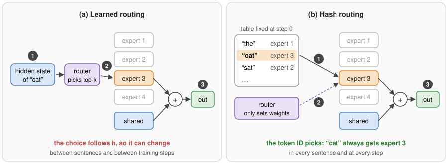
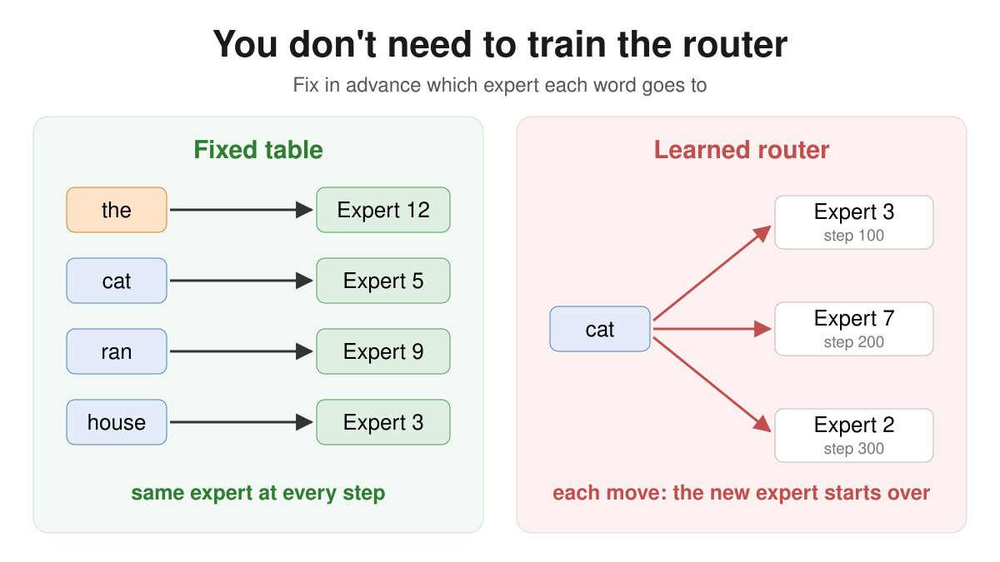
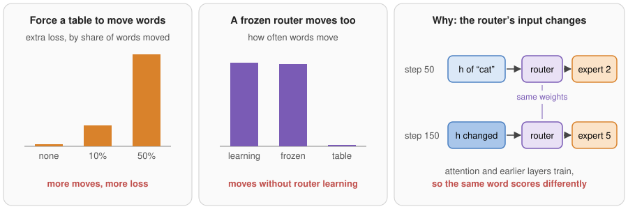
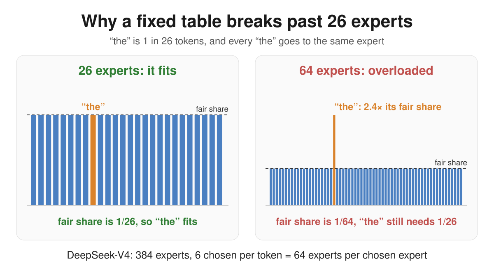
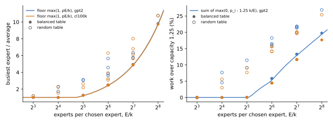
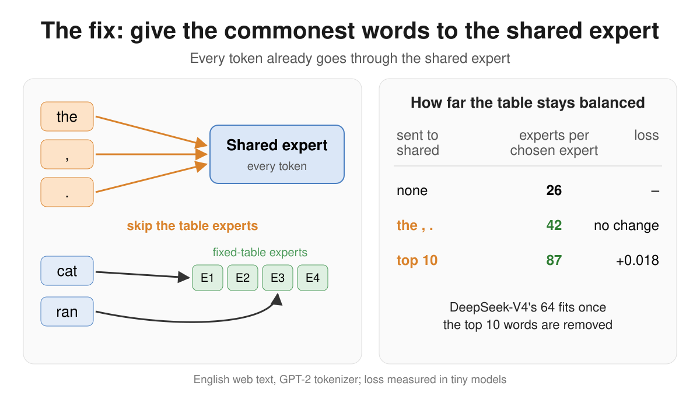
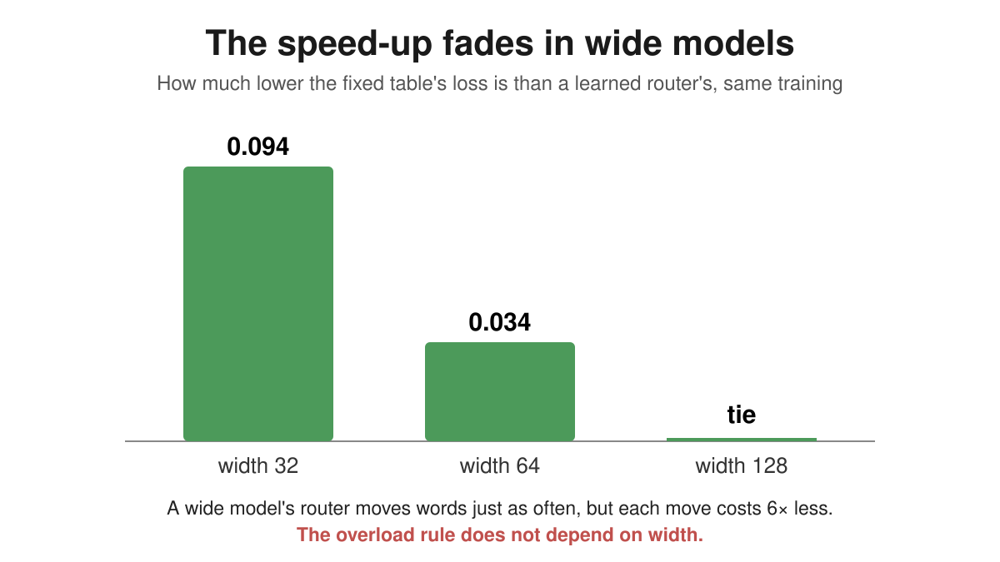
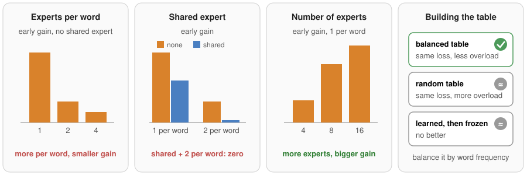

# Hash Routing: When Should Each Token in the Vocabulary Have Its Own Fixed Expert?

Vuk Rosić · **Join: [AI Research School](https://www.skool.com/become-ai-researcher-2669)**

We are writing this paper for ICML 2027. Code under the MIT licence.

> [!IMPORTANT]
> You don't need to train the router in a mixture of experts. A fixed table that sends each word to the same expert trains as well as a learned router. It stays balanced up to about **26 experts per chosen expert**, and up to about **42** once "the", "," and "." go only to the shared expert.

---

## What hash routing is

A **mixture-of-experts** layer has many small expert networks and a **router** that learns which experts each token (a word or a piece of a word) goes to.

**Hash routing** skips the learning. Before training, a fixed table says which expert each word goes to. Every "cat" always goes to expert 5, every "the" always goes to expert 12. DeepSeek-V4 uses this in its first layers.



*(a) A learned router reads the hidden state and picks experts. (b) Hash routing looks the experts up in a fixed table by token ID.*

---

## A fixed table trains as well as a learned router, and faster early

On English web text the table never trained worse than a learned router. In small models it was ahead early in training.



The reason: a learned router keeps moving words between experts, and each time the new expert has to learn that word from scratch. When we made a fixed table move words on purpose, the loss rose with every move.



> **The early loss comes from moving words between experts, and a fixed table never moves them.**

---

## A fixed table breaks past 26 experts per chosen expert

A table sends every copy of a word to the same expert. "The" is 1 in 26 tokens of English web text, so its expert gets at least 1/26 of all the work.

- **26 experts:** each fair share is 1/26, so "the" fits.
- **64 experts:** each fair share is 1/64, but "the" still needs 1/26: **2.4 times** the fair share. No table can fix that.

When each token picks several experts, count **experts per chosen expert** (total experts ÷ experts chosen per token). DeepSeek-V4 has 384 ÷ 6 = 64.



The rule holds exactly in 14 expert designs and 2 tokenizers, computed from word counts with no training:



*Left: the busiest expert's load. The line is the rule; filled dots (frequency-balanced tables) sit on it, open dots (random tables) above it. Right: the work that overflows when each expert can take 1.25 times its fair share.*

---

## Send the most common words to the shared expert

Every token already passes through the **shared expert**. Send "the", "," and "." only there, and the next most common word sets the limit: the table balances up to **42** experts per chosen expert. Ten words lift it to **87**. In our tests this cost no measurable loss.



---

## In wide models the speed-up fades, the load rule stays

We moved one setting at a time toward big models: bigger vocabulary, more layers, more experts, longer context, bigger batches, wider model. Everything held except width.



> **In large models, use a table for balance and simplicity, not for lower loss.**

---

## How to build the table



| Do | Why |
|---|---|
| Sort words by frequency, cut into runs of equal total frequency | Balances the load; rare words share experts with rare words |
| Keep each word on one fixed expert set | Spreading a word over experts costs loss |
| Hash the first layer or first few | They hold almost all of the early gain |
| Keep learned routers in later layers | Words whose job depends on context can be split there |
| Don't switch from table to learned router mid-training | It was worse than either |

---

## How we tested it

We counted how often each token appears in English web text and computed the busiest expert exactly for 14 expert designs and 2 tokenizers. Then we trained hundreds of tiny mixture-of-experts models on a laptop, 5 to 20 seconds each, comparing a fixed table with a learned router and repeating key runs 3 times.

> [!NOTE]
> All trained models have under 2M weights. Large models are imitated with small knobs, never run. DeepSeek-V4's own tokenizer and data mix may give a different "the" share.

**More:** [PAPER.md](PAPER.md) is the full paper with every test, [RESULTS.md](RESULTS.md) the log of every round.

| File | What it does |
|---|---|
| `rule.py` | Exact load for 14 designs and 2 tokenizers (10 s) |
| `hr.py` | Test bed: learned vs table routing, capacity, forced moves (`--help`) |
| `scale.py`, `sweep.py`, `curve.py`, `load.py`, `table.py`, `fit.py` | Large-model knobs, sweeps, gap along training, tables |

Data (not in the repo): GPT-2 token counts and FineWeb shards from the modded-nanogpt FineWeb10B set.

## Cite

```bibtex
@misc{rosic2026hashrouting,
  author = {Rosić, Vuk},
  title  = {Hash Routing: When Should Each Token in the Vocabulary Have Its Own Fixed Expert?},
  year   = {2026},
  url    = {https://github.com/vukrosic/llm-hash-routing}
}
```
